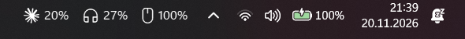

# BatteryHub + Claude

Kablosuz cihazlarının pil seviyesi ve **Claude haftalık kullanım limitin**, ikisi birden Windows görev çubuğunda.



[krisgfx9/Wireless-Device-Battery-Monitor](https://github.com/krisgfx9/Wireless-Device-Battery-Monitor) (BatteryHub) projesinin forku. Pil izleme özelliklerinin tamamı orijinal projeye ait. Bu fork şeride Claude limitini ekliyor ve menüyü sadeleştiriyor.

## Neler var

- **Claude limiti:** şeridin en başında beyaz Claude logosu ve haftalık limit yüzdesi bulunuyor.
  - Üzerine gelince sıfırlanma zamanı ve 5 saatlik limit görünüyor.
  - Limit %90'ı geçince kırmızıya dönüyor. Veri yoksa ya da 6 saatten eskiyse soluk görünüyor.
- **Pil seviyeleri:** mouse, kulaklık, klavye ve kumanda.
  - Desteklenen markalar arasında Logitech, Razer, SteelSeries, Corsair, HyperX, PlayStation, Xbox, Galaxy Buds ve Windows'un pil seviyesini bildiği her Bluetooth cihaz var. Tam liste [orijinal README'de](https://github.com/krisgfx9/Wireless-Device-Battery-Monitor#supported-devices).
- **Sade menü:** "destek iste", "projeyi destekle" ve güncelleme girişleri kaldırıldı. Fork sürümleri orijinal projenin güncellemelerini almadığı için güncelleme girişlerinin bir işlevi kalmamıştı.

## Kurulum

1. [Releases](https://github.com/yatuk/Wireless-Device-Battery-Monitor/releases/latest) sayfasından `BatteryHub-Claude-<sürüm>-portable.zip` dosyasını indir ve istediğin bir klasöre aç.
2. `BatteryHub.exe` dosyasını çalıştır. Kod imzalı olmadığı için SmartScreen uyarı verebilir; *Ek bilgi → Yine de çalıştır* de.
3. Menüdeki *Windows ile başlat* seçeneğini işaretle.

## Claude limitini bağlama

BatteryHub limit verisini `%LOCALAPPDATA%\ClaudeLimitWidget\usage.json` dosyasından okuyor. Bu dosyayı iki yardımcıdan biri yazıyor:

### Claude masaüstü uygulaması ve claude.ai: `claude/desktop-sync`

Küçük bir Electron tepsi uygulaması. Node.js gerektiriyor.

```
cd claude\desktop-sync
npm install
npx electron .
```

- Açılan pencerede claude.ai'ye **kendin** giriş yap. Şifren ve çerezlerin uygulamanın kendi tarayıcı profilinde kalır; dosyaya yazılmaz, kaydedilmez, başka yere gönderilmez.
- İlk başarılı okumadan sonra oturum 30 gün kalıcı yapılır, böylece bilgisayar yeniden başlayınca tekrar giriş gerekmez.
- Açılışta ağ henüz hazır değilse 15 saniyede bir yeniden dener. Durum satırları `%LOCALAPPDATA%\ClaudeLimitWidget\sync.log` dosyasına yazılır.
- Uygulama dakikada bir *Ayarlar → Kullanım* sayfasındaki değerleri okur.
- Tepsi menüsünde *Şimdi yenile* ve *Windows ile başlat* seçenekleri var.
- claude.ai'nin belgelenmemiş iç adresini kullanıyor; claude.ai değişirse bozulabilir.

### Terminaldeki Claude Code: `claude/claude_limit_statusline.py`

Claude Code'un [statusLine](https://code.claude.com/docs/en/statusline) verisindeki belgelenmiş `rate_limits` alanını kaydediyor. Giriş veya ağ erişimi gerektirmiyor; Pro, Max ve Ultra planlarda çalışıyor. `~/.claude/settings.json` dosyasına şunu ekle:

```json
"statusLine": { "type": "command", "command": "python \"<klasör>/claude/claude_limit_statusline.py\"" }
```

Masaüstü uygulaması statusLine komutlarını çalıştırmadığı için orada `desktop-sync` kullanılmalı.

## Kaynaktan derleme

Gereken: [MinGW-w64](https://www.mingw-w64.org/) (örneğin `winget install BrechtSanders.WinLibs.POSIX.UCRT`).

```
build.bat 1.1.0 test
```

`test` kanalı orijinal projenin güncelleme kontrollerini kapatır. Bu sayede fork sürümü bir güncellemeyle orijinal sürüme dönüşmez.

## Komut satırı

```
BatteryHub.exe --list    # cihazları ve pil seviyelerini yazdırır
BatteryHub.exe --json    # aynısını JSON olarak verir
BatteryHub.exe --quit    # çalışan uygulamayı kapatır
```

## Lisans ve emek

- **Lisans:** GPL-3.0, ayrıntılar [LICENSE](LICENSE) dosyasında.
- **Pil izleme:** BatteryHub'ın sürücüleri ve arayüzü [krisgfx9](https://github.com/krisgfx9) ve katkıcılarına ait. Teşekkürler listesi [orijinal README'de](https://github.com/krisgfx9/Wireless-Device-Battery-Monitor#credits). Projeyi beğendiysen orijinal yazarı [Ko-fi](https://ko-fi.com/krisgfx) veya [GitHub Sponsors](https://github.com/sponsors/krisgfx9) üzerinden destekleyebilirsin.
- **Claude:** Claude ve Claude logosu Anthropic'e ait. Bu proje Anthropic ile bağlantılı değildir.
